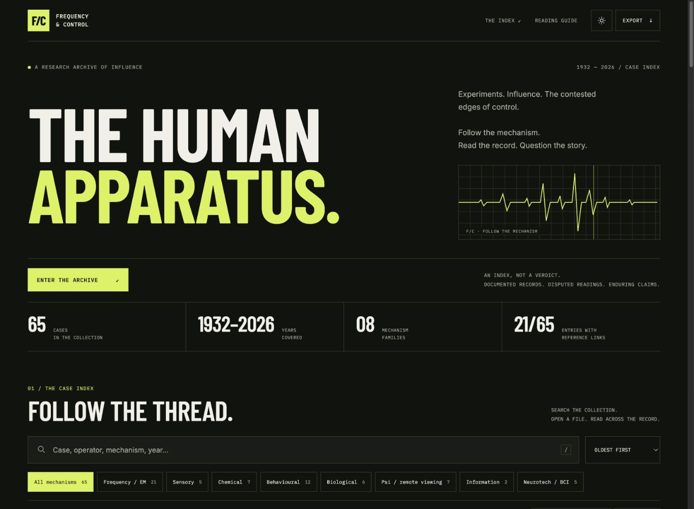

# Frequency & Control

## The Human Apparatus

A free Bub Club project: a bold, browser-based case archive exploring experiments, influence, and the contested edges of control.

**[Open the live archive →](https://frequency-control-case-database.bubba-4041.chatgpt.site)**



## Explore

- **65 supplied cases** spanning 1932–2026, across eight mechanism families.
- Search case names, operators, mechanisms, years, and case text.
- Combine mechanism, evidence-tier, source-link, and decade filters.
- Open a focused case reader with references and related cases.
- Share direct links to individual cases.
- Save cases and analyst notes locally in your browser.
- Export all records to CSV, download a standalone HTML copy, or back up your notes to JSON.
- Responsive desktop and phone layouts, keyboard controls, and dark/light themes.

## Run locally

Open `index.html` directly in a modern browser. For an HTTP preview, run this from the repository folder:

```sh
python3 -m http.server 8000 --bind 127.0.0.1
```

Then open <http://127.0.0.1:8000>. Direct case-sharing links work when the page is served over HTTP or HTTPS.

No package installation, build step, account, API key, or database is required. Google Fonts is optional; the interface has system-font fallbacks.

## Project structure

```text
index.html        Complete application: markup, styles, case data, and JavaScript
README.md         Project overview and local setup
docs/preview.png  Interface preview
```

The public website is currently hosted on ChatGPT Sites. This repository is a source copy; commits here do not automatically change that deployment.

## Notes and saved cases

Notes, bookmarks, and theme preferences use browser-local storage. They do not sync across devices. Shared case URLs include the case identifier, not your notes. Use **Export → Back up my notes** before clearing browser data or moving devices.

## Content provenance

Case text, dates, evidence tiers, status labels, and reference links are preserved from the supplied research archive. The collection contains 21 entries with supplied reference links. These claims have not been independently fact-checked for this edition.

The case reader separates the reported mechanism, the supplied official account, and the supplied editorial interpretation. Inclusion does not establish that a claim is true. Tier labels describe the original archive's classification, not an independent verification by this project.

## Contributing

For case corrections, include sources that directly support the proposed change, distinguish evidence from interpretation, and preserve uncertainty where the record is incomplete. The `D` array in `index.html` contains the case records; summary counts are calculated from those records.

For interface changes, preserve keyboard access, responsive layouts, safe text rendering, and browser-local notes. Never add credentials or private notes to the source or shared URLs.

## Support through Bub Club

Frequency & Control remains free and open access. [Discuss sponsorship with Bub Club](https://headless-xcouzkworss-lucasmclaughlin93-1411.wix-site-host.com/contact.html?interest=frequency-control-sponsor). This opens the project-specific contact page; it does not collect a payment or start a subscription.

Share the live archive using its **Copy archive link** button. Individual case links remain available in each case reader.
